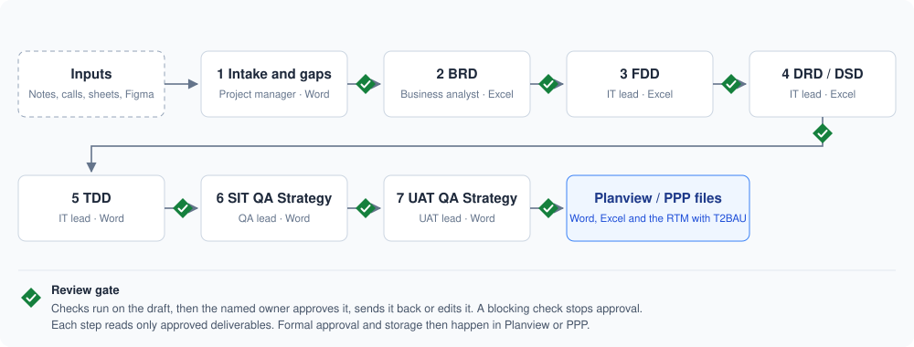
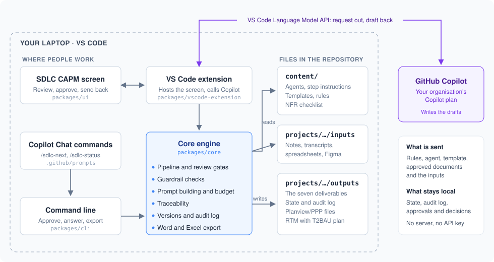
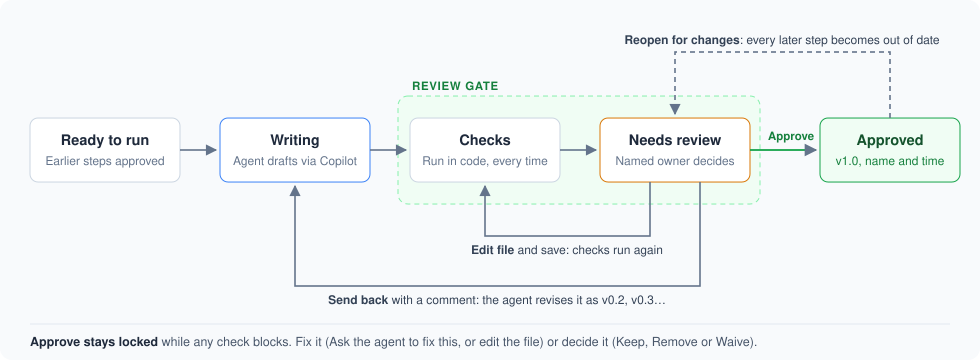
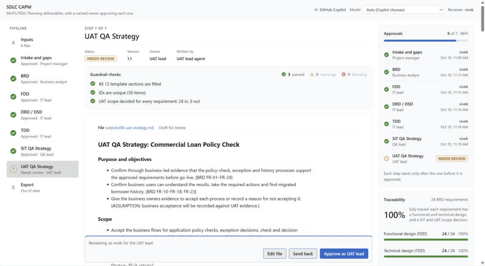
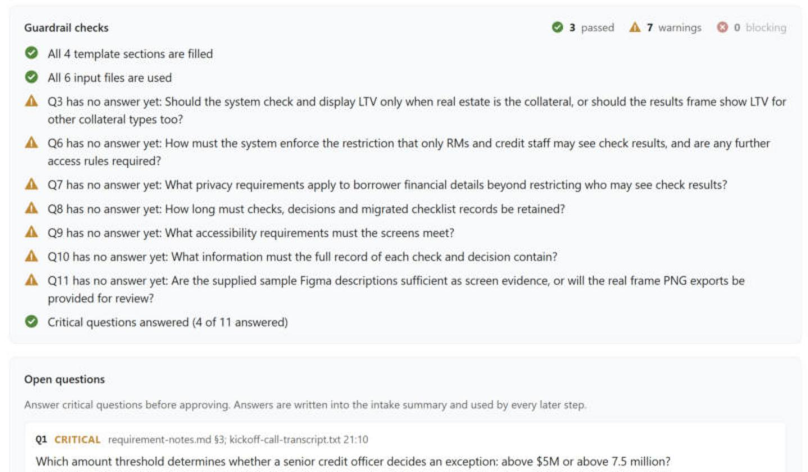
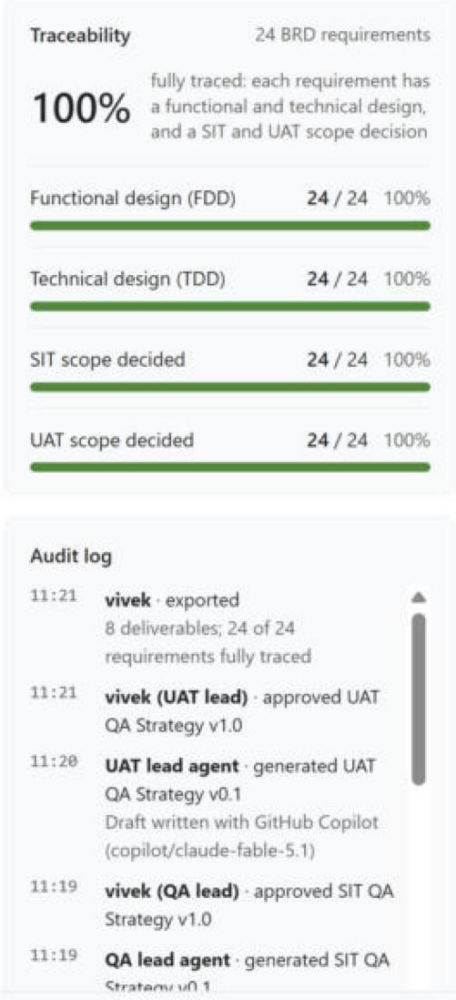
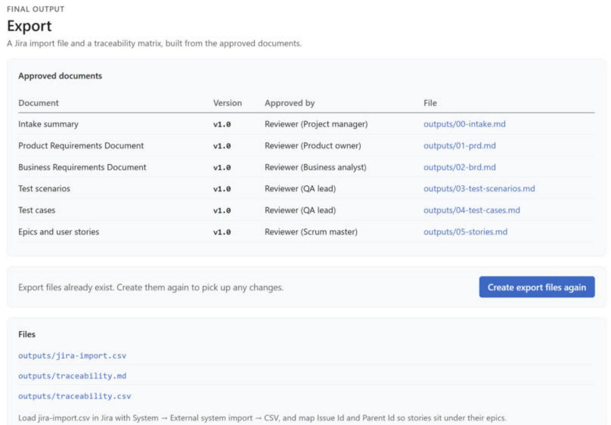

# SDLC CAPM – User Guide

Last updated: 19 October 2026 · Source code: [github.com/vivekprojects-GIT/SDLC-Automation](https://github.com/vivekprojects-GIT/SDLC-Automation)

SDLC CAPM writes MUFG's PDLC Planning-phase deliverables from a project's raw material: requirement notes, call transcripts, legacy spreadsheets and Figma screens. GitHub Copilot drafts each deliverable in MUFG's layout: the BRD, the Functional Design Document, the Data Requirement and Data Sourcing Documents, the Technical Design Document, and the SIT and UAT QA Strategies. Checks written in code catch gaps and invented content, and the named owner approves each deliverable before the next one starts. The result is a set of Word and Excel files, plus the Requirements Traceability Matrix with its Transition to BAU plan, ready to submit to Planview or PPP. It runs inside VS Code on your laptop, with nothing to host and no API key.

## How it works at a glance

Seven deliverables are written in order. Each one stops at a review gate until its owner approves it, and only then does the next one start.



The order follows MUFG's PDLC: work in Planning is sequential and gate-driven, so the FDD starts only once the BRD is approved, and so on. Each step reads only the approved deliverables before it, so a mistake caught at one gate never flows into the next.

### What runs where

Everything runs inside VS Code on your laptop. The only thing that leaves it is the request to GitHub Copilot, through your organisation's Copilot plan.



- **Three ways in, one engine.** The SDLC CAPM screen, the Copilot Chat commands and the command line all drive the same core engine, so the gates, checks and records are identical whichever you use.
- **Content is plain files.** Agents, step instructions, templates, rules and the NFR checklist live in `content/` and can be changed without code.
- **Records stay local.** Approvals, reviewer decisions and the audit log are kept in the project's `outputs` folder and are never sent to the AI. Copilot sees only what a step needs: the rules, the agent, the template, the inputs and the approved deliverables before it.

## What you need before you start

| Need | How to check |
| --- | --- |
| VS Code 1.95 or newer | Help → About |
| GitHub Copilot, signed in | The Accounts icon at the bottom left shows your GitHub account |
| Node.js 20 or newer | Run `node -v` in a terminal |
| Approval to send project material through GitHub Copilot | Needed before using real MUFG material; the bundled sample is made-up data |

## Install and run the sample

**1. Get the code and install the tool**

```bash
git clone https://github.com/vivekprojects-GIT/SDLC-Automation.git SDLC_CAPM
```

Then, in a terminal inside the `SDLC_CAPM` folder:

```bash
npm install
```
```bash
npm run install-extension
```

`install-extension` builds the tool, packages it and installs it into VS Code as **SDLC CAPM**. Run it again whenever you get a newer version.

**2. Open the folder in VS Code**

1. **File → Open Folder** and choose `SDLC_CAPM`.
2. If a yellow **Restricted Mode** bar appears, click **Manage** and choose **Trust**. VS Code switches Copilot off in untrusted folders.

**3. Run the sample project**

1. Click **SDLC CAPM** in the status bar at the bottom, or run **SDLC CAPM: Open SDLC CAPM** from the Command Palette.
2. Leave **Model** in the top bar on **Auto**.
3. Click **Run pipeline**. The first time, VS Code asks whether SDLC CAPM may use the language models provided by GitHub Copilot: click **Allow**.
4. After about a minute the intake summary appears. Answer the critical questions, then click **Approve**. The next step starts on its own.
5. Carry on through the BRD, FDD, DRD/DSD, TDD and both QA strategies. Then open **Export** and click **Create Planview/PPP files**.

The sample, `projects/sample-commercial-loan`, is a made-up commercial loan project, so it is safe to run as often as you like. It comes with a finished run in its `outputs` folder, so you can open every deliverable, the RTM and the Jira import before running anything. To start it again, delete its `outputs` folder.

## Start your own project

1. Copy `projects/sample-commercial-loan` to `projects/<your-project>`, then delete the copy's `inputs` and `outputs` folders.
2. In `project.yaml`, set the name, the type (`new-build`, `migration` or `enhancement`), the template pack and who owns each deliverable.
3. Put your material in `projects/<your-project>/inputs/`, and screen designs in `inputs/figma/`.
4. Close the SDLC CAPM tab and open it again, so the new project appears in the project list in the top bar. Pick it, then click **Run pipeline**.

Each project keeps its own settings, inputs, deliverables and memory:

```
projects/<your-project>/
├── project.yaml   ← how the tool runs this project
├── inputs/        ← the material you give it (read by the AI)
└── outputs/       ← the deliverables, approvals and audit log
```

## Giving inputs

| Kind | Formats | Where |
| --- | --- | --- |
| Requirement notes, specifications, important emails | `.md`, `.txt`, `.docx` | `inputs/` |
| Call and JAR/JAD session transcripts or minutes | Teams or Zoom exports (`.vtt`, `.srt`), or `.txt`, `.md`, `.docx` | `inputs/` |
| Legacy data, current checklists, system extracts | `.xlsx`, `.xls`, `.csv` | `inputs/` |
| Figma screens | `.png` or `.jpg` exports, or a short `.md` description of the frame | `inputs/figma/` |

**Teams and Zoom transcripts.** Download the meeting transcript as `.vtt` and drop it in `inputs/` as it is. The tool turns it into one line per speaker turn, such as `[12:40] Priya Shah: …`, so the deliverables can cite the exact moment, and the intake check lists any part of the meeting it never used.

**Limits.** PDF is not read yet; save it as `.docx` or `.txt`. Only the first 200 rows of each spreadsheet sheet are read. Intake reads about eight to nine hours of transcripts, or a few hundred pages of notes, at once; beyond that it reads what fits and names the files it shortened.

**What helps the deliverables most:**

1. **Include the requirement sessions.** MUFG's BRD must show the calls and workshops requirements came from. Add each session's transcript or minutes, with its date and attendees at the top.
2. **Number the sections of notes with §**, for example `## §2 Policy rules`. The deliverables then cite "requirement-notes.md §2".
3. **Keep the timestamps.** A Teams or Zoom `.vtt` export has them already. For typed transcripts, start each line with one, for example `[12:40] Credit lead: …`. The deliverables then cite "transcript 12:40", and the tool flags any timestamp the intake never used.
4. **Add what the IT leads know about the systems:** system names, table names, columns and interfaces. Without them, the FDD, DSD and TDD mark those details as ASSUMPTION instead of inventing them.
5. **Write numbers exactly.** "At least 1.25x" and "$5M" are carried into the BRD and checked.

## The deliverables

| Step | Built from | Contains | Approved by (default) | Exported as |
| --- | --- | --- | --- | --- |
| 1. Intake and gaps | Every input file and Figma frame | A summary, key facts with their sources, and open questions with a severity | Project manager | Word |
| 2. BRD | The approved intake and its answers | MUFG's BRD tabs, with every requirement given a BRD ID, a type, a source and a priority | Business analyst | Excel, one tab per section |
| 3. FDD | The BRD and intake | One functional design item per BRD requirement: the functional change, systems, tables and number of columns | IT lead | Excel |
| 4. DRD / DSD | The BRD, FDD and input files | The impacted data attributes (DRD tab), their source-to-destination mapping and transformation logic, and any manual workarounds | IT lead | Excel |
| 5. TDD | The BRD, FDD and DSD | The single detailed design: technical design items, ETL jobs, data model changes, error handling and deployment | IT lead | Word |
| 6. SIT QA Strategy | The BRD, FDD, DSD and TDD | Scope, approach, environments, data, entry and exit criteria, defects, roles, schedule and risks, and a scope decision for every requirement | QA lead | Word |
| 7. UAT QA Strategy | The BRD, FDD and SIT strategy | The business processes to accept, participants, sign-off criteria, and a scope decision for every requirement | UAT lead | Word |
| Export | All approved deliverables | The Requirements Traceability Matrix with its Transition to BAU plan | — | Excel |
| Export | The approved BRD, FDD and TDD | The Jira import: an epic per functional change, a story per FDD item, a sub-task per TDD item | — | Excel and CSV |

**The BRD's tabs** follow the layout described on MUFG's discovery call: Stakeholders, Requirement sessions, Business objectives, High-level scope, Current state, Future state, Data flows, Detailed requirements, Non-functional requirements, Functional changes, Impacted systems, System interfaces, Report requirements, and In scope and out of scope, plus Assumptions and constraints. A tab that does not apply says so in one line. The detailed requirements carry a type: Functional, Data, Report, Interface or Validation.

**The FDD stays high level**, as MUFG's does: systems, tables and the number of columns. Column-level mapping and transformation rules belong in the DSD.

**The DRD/DSD** has three working tabs: Data requirements (DRD) lists every impacted attribute with the BRD and FDD IDs it serves; Data sourcing gives each attribute's source, destination and transformation; Manual workarounds records data that no system holds and must be entered through a form such as Wdesk, with its owner and reviewer.

### Who writes them: the agents

An agent is not a program that makes decisions. It is four plain text files that the tool combines into one request to Copilot:

| Part | File |
| --- | --- |
| Who the agent is | `content/agents/<agent>.md` |
| What this step must do | `content/steps/<step>.md` |
| The shape of the deliverable | `content/templates/<pack>/<step>.md` |
| Rules every agent follows | `content/rules.md` |

Four agents write the deliverables: the **business analyst** (intake, BRD), the **IT lead** (FDD, DRD/DSD, TDD), the **QA lead** (SIT QA Strategy) and the **UAT lead** (UAT QA Strategy). An agent never approves a deliverable or starts the next step.

## Reviewing and approving

Every draft waits for its owner. The checks run first, then the owner approves it, sends it back or edits it.



| Action | What happens |
| --- | --- |
| **Approve** | The deliverable becomes v1.0, with the approver's name and time recorded, and the next step starts. Refused while any check blocks. |
| **Send back** | The agent revises the draft (v0.2, v0.3…) and it returns for review. |
| **Ask the agent to fix this** | One click on a failed check sends the draft back with the right comment already written. |
| **Edit file** | Opens the Markdown file. Change it directly; when you save, the tool records the edit and runs the checks again. |
| **Keep / Remove / Waive** | Settles a flagged item: keep or remove a requirement with no source, or waive a checklist topic or intake fact that does not apply. |
| **Use suggestion** | Fills an intake question with the answer the inputs point to. |
| **Reopen for changes** | Reopens an approved deliverable. Every later step is marked out of date and must be written and approved again. |

These approvals are the team's own review before submission. MUFG's formal approval, by the reviewers the project's risk rating requires, still happens in Planview or PPP.

### Reading the screen



*The UAT QA Strategy waiting for review: the pipeline on the left, the deliverable with its checks in the middle, and Approvals and Traceability on the right.*

| Area | What it shows |
| --- | --- |
| Top bar | The project, the AI connection (GitHub Copilot), the **Model** picker and your reviewer name |
| Pipeline (left) | Every step in order, from **Inputs** to **Export**. A green tick means approved, a spinner means the agent is writing, a number in an amber ring is waiting for review, and a grey number has not started. |
| Deliverable (middle) | The step's record: **Status**, **Version**, **Owner**, **Written by** and **Approved**, then the guardrail checks and the draft. The review bar stays at the bottom while you scroll. |
| Governance (right, or below on a narrow window) | **Approvals**, **Traceability** and the **Audit log** |

- **Guardrail checks** open with a summary such as "4 passed · 1 warning · 0 blocking". Each check is marked with a green tick, an amber triangle (warning) or a red cross (blocks approval).
- **Approvals** shows how many of the seven deliverables are approved, and who approved each and when.
- **Traceability** shows the share of BRD requirements that are **fully traced**: each has a functional design item, a technical design item, and a SIT and a UAT scope decision. One bar each shows the FDD, TDD, SIT scope and UAT scope, with the requirement IDs still missing listed under the bar.
- **Audit log** lists every action, by people and by agents, newest first. It is saved in `outputs/audit-log.csv` and never sent to the AI.



*The intake's checks: the unanswered normal questions are warnings, so approval is not blocked; the critical ones are answered below.*



*A finished project: all 24 BRD requirements fully traced, and the audit log of who did what.*

## Quality checks

The checks are written in code, not left to the AI, so they behave the same on every run. A **block** stops approval until it is fixed or decided; a **warning** is shown but does not stop it.

| Step | Check | Level |
| --- | --- | --- |
| All | Every section of the template is present and filled | Block |
| All | Every ID (FR-01, FD-03…) is used only once | Block |
| All | Numbers that look like card or national ID numbers | Warning |
| Intake | Every input file is used | Block |
| Intake | Every numbered section (§2) and transcript timestamp (12:40) is used | Warning |
| Intake | Every critical open question is answered | Block |
| BRD | Every requirement cites a real source: an input file, an approved deliverable or an answered intake question. One backed only by ASSUMPTION must be kept or removed | Block |
| BRD | Every requirement has a type | Warning |
| BRD | Security, personal data, retention, accessibility, audit and performance are covered (or waived) | Block |
| BRD | Every key fact from the intake reaches the BRD (or is waived as context) | Block |
| BRD | The values in those facts, such as 1.25x or $10M, appear in the BRD | Warning |
| FDD | Every functional design item names the BRD requirement it serves | Block |
| FDD | Every BRD requirement has a functional design item | Block |
| DRD / DSD | Every data attribute names the requirement or design item it serves | Block |
| DRD / DSD | Every data attribute has a source-to-destination mapping | Block |
| TDD | Every technical design item names the functional design item it builds | Block |
| TDD | Every functional design item has a technical design item | Block |
| SIT and UAT QA Strategies | Every BRD requirement is marked in or out of scope | Block |

What no check can judge, such as whether a design is the right one, is left to the person who approves.

## Outputs and the Planview/PPP files

Everything is written to the project's `outputs` folder.

| File | What it is |
| --- | --- |
| `00-intake.md` … `06-uat-strategy.md` | The seven deliverables as Markdown, each with a header giving its version, status, owner, template, the agent and model that wrote it, and who approved it and when |
| `deliverables/` | **The Planview/PPP files**, created by **Create Planview/PPP files** after every step is approved |
| `rtm.md`, `rtm.csv` | The Requirements Traceability Matrix, for review in VS Code |
| `audit-log.csv` | Every action, by people and by agents |
| `pipeline-state.json` | The tool's memory for the project: versions, answers, decisions and history |

**In `deliverables/`:**

| File | Format |
| --- | --- |
| `00-intake.docx` | Word |
| `01-brd.xlsx` | Excel: Document control, then one tab per BRD section |
| `02-fdd.xlsx` | Excel |
| `03-dsd.xlsx` | Excel, including the DRD tab |
| `04-tdd.docx`, `05-sit-strategy.docx`, `06-uat-strategy.docx` | Word |
| `rtm.xlsx` | Excel: the RTM, a Coverage tab and Document control |
| `jira-import.csv` | The file Jira's CSV import reads |
| `jira-import.xlsx` | Excel: the same issues to review, the import steps and Document control |



*The Export page: each deliverable with its version, approver and format, and the RTM generated from them.*

Every Word file opens with a **Document control** table, and every workbook with a **Document control** tab: the document, project, version, status, owner, who approved it and when, and which agent and model wrote it. Word and Excel files open in Office from the Export page.

**The RTM** has one row per BRD requirement: its BRD ID, type, source and priority; the FDD items, data attributes and TDD items that realise it; whether SIT and UAT have it in scope; and its trace status. The four **Transition to BAU** columns (BAU owner, transition activity, BAU readiness check, target date) are left for the BAU owner to complete, as nothing in the Planning deliverables says who will run the service after go-live.

The project manager then uploads the files to Planview or PPP for the approval workflow the PDLC Procedure requires.

### The Jira import

Once the Planning deliverables are approved, the work is already broken into numbered items, so the export turns them into Jira issues for the delivery team. It is built in code from the approved deliverables: no AI request and no extra review gate.

| Jira issue | Comes from | Issue Id | Parent |
| --- | --- | --- | --- |
| Epic | Each row of the BRD's Functional changes tab | EP-01, EP-02… | — |
| Story | Each FDD item: the functional change, systems, tables and screens, with its BRD requirements as acceptance criteria | The FDD ID (FD-01) | The epic whose functional change lists its BRD requirement |
| Sub-task | Each TDD item: the component and design | The TDD ID (TD-01) | The first FDD item it builds |

Each issue keeps the BRD IDs it delivers, in its labels and in a BRD IDs column, so a ticket traces back to the requirement and the RTM. Priority follows the BRD: Must becomes High, Should Medium, Could Low. Requirements that no functional change lists go under an epic called Other requirements; removed requirements are left out.

To load it, open **System → External system import → CSV** in Jira and choose `jira-import.csv`. Map **Issue Id** and **Parent Id** so stories sit under their epics and sub-tasks under their stories. The tool never connects to Jira itself: someone with access to MUFG's Jira imports the file. The `How to import` tab of `jira-import.xlsx` lists the steps. If MUFG's Jira names its issue types or priorities differently, change them in the CSV before importing.

## Customising without code

Everything here is a plain text file. A PM, BA, IT lead or QA lead can change it in VS Code without a developer or a rebuild. New drafts use the change at once.

| To change | Edit |
| --- | --- |
| The layout of a deliverable | `content/templates/<pack>/<step>.md` |
| How an agent thinks and writes | `content/agents/<agent>.md` |
| What a step must do | `content/steps/<step>.md` |
| Rules every agent follows | `content/rules.md` |
| Topics every BRD must cover | `content/checklists/nfr.md` |
| The fonts, colours and heading styles of the Word files | `content/templates/<pack>/word-template.docx` |
| A project's owners, step order, templates and limits | `projects/<project>/project.yaml` |

### Add MUFG's own templates

1. Create a folder beside the standard set: `content/templates/mufg/`.
2. Copy in only the templates you want to change from `content/templates/standard/`: any of `intake.md`, `brd.md`, `fdd.md`, `dsd.md`, `tdd.md`, `sit-strategy.md` and `uat-strategy.md`. Any you leave out fall back to the standard set.
3. To give the Word files MUFG's look, save a Word document with MUFG's styles as `content/templates/mufg/word-template.docx`. Its fonts, colours and heading styles are used.
4. In the project's `project.yaml`, set `templatePack: mufg`.

**Rules a template must follow, because the checks and the RTM read the deliverables:**

- Every `## heading` becomes a required section, and a tab of the Excel workbook. Text inside `<!-- … -->` is guidance for the agent; `{{project}}` becomes the project name.
- **Tables of numbered items** keep the ID in the first column: BRD ID (FR-01), FDD ID (FD-01), DRD ID (DA-01), Mapping ID (DS-01) and TDD ID (TD-01). Other columns are up to you.
- **BRD:** keep a `Source` column, and a `Type` column in Detailed requirements.
- **FDD, DSD and TDD:** each row names the IDs it serves (an FDD row its BRD ID, a DRD row its BRD or FDD ID, a mapping row its DRD ID, a TDD row its FDD IDs).
- **QA strategies:** keep the `Requirements in scope` table, with a column whose header contains "scope" holding Yes or No.

MUFG's real templates are the next step: these standard templates follow what was described on the discovery call, and should be replaced once MUFG shares its BRD and other templates.

### Change the mandatory BRD topics

Each line of `content/checklists/nfr.md` is a topic, then the words that count as covering it:

```
- Accessibility: accessibility, wcag, screen reader
```

### Project settings

```yaml
name: Commercial Loan Policy Check
type: migration            # new-build | migration | enhancement
templatePack: standard
stageOrder: [intake, brd, fdd, dsd, tdd, sit-strategy, uat-strategy]
owners:
  intake: Project manager
  brd: Business analyst
  fdd: IT lead
  dsd: IT lead
  tdd: IT lead
  sit-strategy: QA lead
  uat-strategy: UAT lead
budget:                    # all optional
  # maxInputTokens: 60000  # cap one request below the model's own limit
  # maxOutputTokens: 8000  # how long one reply can safely be (the default)
  # chunkSize: 10          # requirements per FDD piece, design items per TDD piece
```

- **owners** are the role names shown on the Approve button and in the audit log.
- **stageOrder** must start with `intake`. A project without data changes can leave out `dsd`; the TDD then works from the BRD and FDD.

In VS Code Settings (search "SDLC CAPM") you can also set **Reviewer name** (your name in approvals and the audit log) and **Auto advance** (start the next step after an approval).

## Using Copilot Chat instead of the screen

People who already work in Copilot Chat can drive the same pipeline from there. Both routes use the same engine, so the review gates, checks, versions and audit log are identical.

| In Copilot Chat | What it does |
| --- | --- |
| `/sdlc-next` | Writes the next deliverable that is ready, then stops for review |
| `/sdlc-revise` | Revises a draft for a reviewer's comment |
| `/sdlc-status` | A plain-words summary of where every project stands and who needs to act |

Copilot is told never to approve, answer intake questions or settle flagged items itself. Approvals stay with people, in the screen or from a terminal:

```bash
npm run sdlc -- approve brd --project sample-commercial-loan --as "Your Name"
```

Run `npm run sdlc -- help` for every command: `status`, `answer`, `resolve`, `approve`, `reopen`, `prompt`, `register` and `export`.

## AI models, long documents and records

- **Choosing the model.** The **Model** list in the top bar shows the Copilot models your account can use. **Auto** picks the most capable one.
- **Request size.** Each request stays within 80% of the chosen model's limit. Intake shortens the largest input files when everything does not fit, and warns the reviewer.
- **Long documents.** A long FDD is written a few BRD requirements at a time, and a long TDD a few FDD items at a time; the pieces are joined and the summary recounted.
- **Automatic gap filling.** After writing, the tool checks that every BRD requirement has its FDD item and every FDD item its TDD item. A reply that stopped mid-table has its broken row dropped. Up to two more requests then write only the missing items, before the reviewer sees the draft.
- **Records kept.** Every deliverable keeps its version history, the audit log records every action, and the agent and model that wrote each draft are in its header.
- **Data handling.** Input files and approved deliverables are sent to Copilot under your organisation's agreement; approvals, decisions and the audit log never are.

## Troubleshooting

| What you see | What to do |
| --- | --- |
| No **SDLC CAPM** button in the status bar | Open the `SDLC_CAPM` folder itself, the one with `content/steps` and `projects/` |
| "No model available" or Copilot is not connected | Trust the folder (Restricted Mode turns Copilot off), sign in to Copilot, and click **Allow** when VS Code asks |
| A new project does not appear in the list | Close the SDLC CAPM tab and open it again |
| A draft keeps the same blocking check | Click **Ask the agent to fix this**, or edit the file directly and save |
| Many cells say ASSUMPTION in the FDD, DSD or TDD | The inputs lack system, table or column details. Add the IT leads' documentation to `inputs/` and reopen the step |
| "is open in another program" on export | Close that Word or Excel file, then export again |

## Limits and open questions

**What it does not do yet:**
- Execution-phase deliverables (DUT, SIT and UAT cases, execution and exit reports), Initiation deliverables (IPR, PIRR), TOM, the Technology Deployment Plan, the Project Plan/WBS and the BAF.
- Stage-level Assurance Gates, and approval depth that follows the project's risk rating: each deliverable has one approver in the tool.
- Submitting to Planview or PPP automatically: files are uploaded by the project manager.
- Creating Jira issues directly: the Jira import file is loaded by someone with access to MUFG's Jira.
- Reading PDF inputs, or pulling inputs from SharePoint, Confluence or Git.

**Open questions from MUFG's discovery call** that will change the templates or the flow: who owns and writes the BRD; how many BRD templates exist; whether other projects use a different format; whether scope stays at Planning or grows to the full SDLC; and whether MUFG keeps Planview.

**Does the AI decide what goes into the deliverables?** No. It writes drafts. A named person approves every deliverable, and the audit log records who approved what. Anything the AI cannot trace to a source is flagged for a person to keep or remove.
